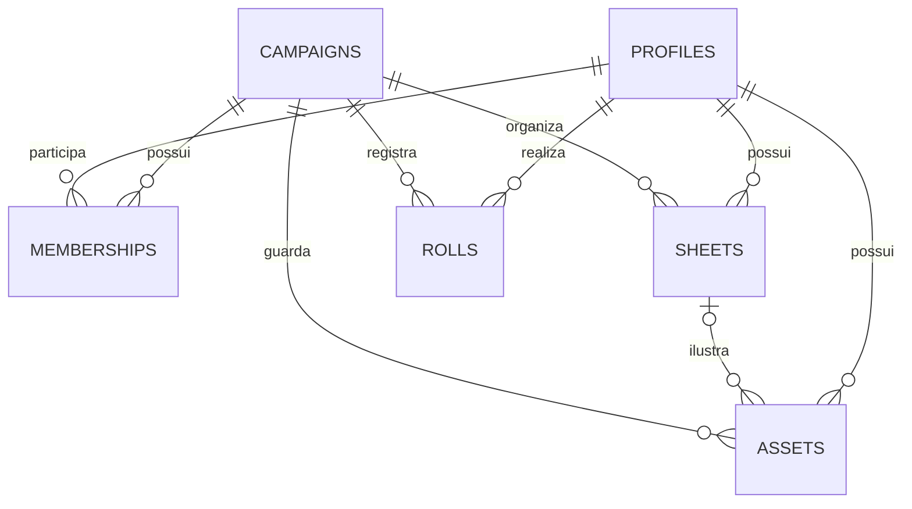

# Banco de dados do Nexo

Este documento descreve o contrato mantido em `supabase/migrations/`. Para autenticação e autorização, leia [AUTH_AND_PERMISSIONS.md](AUTH_AND_PERMISSIONS.md). Para instalação, publicação e recuperação, leia [OPERATIONS.md](OPERATIONS.md).

## Onde cada dado fica

| Local | Conteúdo | Responsável |
| --- | --- | --- |
| Supabase Auth, schema `auth` | Conta, identidade, hash de senha, confirmação, sessões | Serviço Supabase Auth |
| PostgreSQL, schema privado `nexo` | Perfil, campanhas, participação, fichas, rolagens e metadados de imagens | API autenticada do Nexo |
| Storage, bucket privado `nexo-assets` | Bytes dos retratos, tokens e mapas | API do Nexo + transferência assinada do Storage |
| Realtime, canal privado por campanha | Aviso de que houve uma alteração | Triggers do banco; nenhum conteúdo de ficha no aviso |
| Navegador | Demonstração em `localStorage`; rascunhos em `sessionStorage`; sessão Supabase em cookies | Interface |
| GitHub | Código, migrações, testes e exemplos fictícios | Desenvolvimento |

O projeto de produção é `nexo-rpg`, região `sa-east-1`. A Vercel executa o frontend Next.js e encaminha a sessão para a Edge Function `nexo-game`. Não há senha de banco nem chave administrativa no frontend ou na Vercel.

## Convenções

- IDs de contas atuais: `supabase:<uuid de auth.users.id>`. IDs antigos do ChatGPT foram preservados. Não associe contas por nome ou e-mail.
- IDs de campanhas, fichas e rolagens são textos gerados pela aplicação, normalmente UUIDs. Não converter as colunas existentes para UUID: há IDs legados.
- Datas usam `timestamptz`, armazenadas como instantes e exibidas no fuso do usuário.
- Campos são obrigatórios, exceto quando a tabela abaixo informa `NULL`.
- `gm` significa mestre daquela campanha; `player` significa jogador. Não existe administrador global na aplicação.
- `data` é `jsonb`. O domínio TypeScript hidrata o JSON junto às colunas relacionais. As colunas `id`, `campaign_id`, `owner_id`, `type`, `version` e `updated_at` são a fonte de verdade quando houver uma cópia desses valores no JSON.

## Relações

`imports` registra uma transferência técnica e `query_allowlist` contém o registro fechado de SQL; não são entidades de jogo. `rolls.sheet_id` não possui FK para preservar o histórico após excluir uma ficha. `assets.object_path` aponta para um objeto do Storage, sem FK entre serviços.

## `nexo.profiles`

Criado no primeiro acesso autenticado à API. Não guarda e-mail nem senha.

| Coluna | Tipo / padrão | Significado e restrições |
| --- | --- | --- |
| `id` | `text`, PK | Identidade estável; 1–100 caracteres; prefixo de provedor quando aplicável |
| `name` | `text` | Nome de exibição na mesa; 1–80 caracteres no banco; edição pela API exige 2–80 |
| `created_at` | `timestamptz`, `now()` | Primeiro acesso ao Nexo |

Não há FK direta para `auth.users`, pois também existem identidades do ChatGPT. Excluir uma conta de Auth não elimina automaticamente seu perfil ou suas fichas. Exclusão de conta e transferência de mesas exigem uma operação administrativa própria, ainda sem interface.

## `nexo.campaigns`

| Coluna | Tipo / padrão | Significado e restrições |
| --- | --- | --- |
| `id` | `text`, PK | Identificador da campanha |
| `name` | `text` | Nome; API limita a 100 caracteres |
| `description` | `text` | Descrição; API limita a 2.000 caracteres |
| `system` | `text` | `ordem`, `jujutsu`, `dnd`, `cthulhu`, `tormenta` ou `custom` |
| `banner` | `text` | Arte de capa: `shrine`, `forest`, `ruins` ou `abyss` |
| `status` | `text` | `active` ou `paused`; pausa é informativa, não bloqueia edição |
| `invite_code` | `text`, UNIQUE | Convite de entrada. API atual gera 20 caracteres hexadecimais; somente o mestre recebe o código nas respostas |
| `created_at` | `timestamptz`, `now()` | Criação |

O sistema não muda depois de criar a campanha, para não reinterpretar fichas existentes. Um novo sistema exige alterações coordenadas em `types.ts`, `systems.ts`, `validation.ts`, regras de dados e uma nova migração da constraint.

## `nexo.memberships`

| Coluna | Tipo | Significado e restrições |
| --- | --- | --- |
| `campaign_id` | `text`, FK | Campanha; exclusão da campanha remove a participação |
| `user_id` | `text`, FK | Perfil; exclusão do perfil remove a participação |
| `role` | `text` | `gm` ou `player` |

A PK composta `(campaign_id, user_id)` impede participação duplicada. O índice `memberships_user_idx(user_id, campaign_id)` atende a listagem das campanhas de uma pessoa. O índice parcial único `memberships_gm_idx(campaign_id) WHERE role='gm'` permite **no máximo um mestre por campanha**; a criação de campanha grava campanha e mestre juntos. Não há fluxo de troca de mestre ou de co-mestres.

Remover um jogador apaga a participação, preservando perfil, fichas e histórico. O jogador perde acesso à campanha; se entrar novamente, recupera suas fichas. O mestre continua vendo as fichas preservadas. Renovar o código impede o uso do código anterior, mas não remove participantes já inscritos.

## `nexo.sheets`

| Coluna | Tipo / padrão | Significado e restrições |
| --- | --- | --- |
| `id` | `text`, PK | Identificador da ficha |
| `campaign_id` | `text`, FK | Campanha; exclusão da campanha remove a ficha |
| `owner_id` | `text`, FK | Perfil proprietário; FK impede excluir um perfil ainda referenciado |
| `type` | `text` | `character` ou `monster`; criaturas são privadas do mestre |
| `data` | `jsonb` | Objeto com os campos de jogo abaixo; validação detalhada na API |
| `version` | `integer`, `1` | Revisão positiva para concorrência otimista |
| `updated_at` | `timestamptz`, `now()` | Última gravação confirmada |

Índices: `sheets_campaign_idx(campaign_id)` e `sheets_owner_idx(owner_id)`.

### Contrato de `sheets.data`

Veja a fonte executável em `lib/game/types.ts` e `lib/game/validation.ts`. Limites abaixo são os da API de edição; o banco exige um objeto JSON, não replica todo o schema Zod.

| Campo | Tipo / limites | Uso |
| --- | --- | --- |
| `system` | Um `SystemId` | Sistema fixado ao criar a ficha |
| `name` | Texto, 1–100 | Nome do personagem/criatura |
| `className`, `origin` | Texto, até 100 cada | Classe e origem |
| `level` | Inteiro, 1–100 | Nível |
| `exposure` | Inteiro, 0–100 | NEX/exposição |
| `defense` | Inteiro, 0–999 | Defesa |
| `attributes` | Objeto `chave: inteiro` | Chaves até 10 caracteres; valores -10–100; Ordem/Jujutsu exigem os atributos do sistema entre 0 e 10 |
| `resources` | Objeto `hp`, `ep`, `sanity` | Cada recurso contém `current` e `max`; máximo 1–9.999 e atual 0–máximo |
| `skills` | Array, até 60 | `{ id, name, attribute, bonus }`; bônus -100–200; atributo deve existir |
| `attacks` | Array, até 30 | `{ id, name, skillId, damage, range, critical, description }`; perícia deve existir; crítico 2–20 |
| `rituals` | Array, até 100 | `{ id, name, element, circle, summary, sourcePage }`; círculo 1–4; elementos Conhecimento/Energia/Morte/Sangue/Medo |
| `abilities` | Array, até 40 | `{ id, name, cost, formula, description }`; custo 0–9.999; descrição até 4.000 |
| `inventory` | Texto, até 12.000 | Equipamento e itens |
| `notes` | Texto, até 20.000 | Anotações privadas à audiência da ficha |
| `description` | Texto, até 4.000 | Descrição |
| `tone` | Enum | `blue`, `violet`, `rose`, `amber`, `green` |
| `portraitAssetId` | UUID textual, opcional | Definido somente pela ação de mídia, depois de verificar arquivo, ficha e versão; edição comum não aceita forjar esse vínculo |

Campos de identidade e autoria podem constar no JSON por compatibilidade, mas o cliente não os altera por `update_sheet`. IDs de perícias, ataques e habilidades não podem se repetir dentro da respectiva lista. Fórmulas aceitam um grupo como `1d20+5`, `3d20kh1+5` ou `2d20kl1`; até 30 dados, 2–1.000 lados e bônus entre -1.000 e 1.000.

### Concorrência

Uma edição completa envia a versão que abriu. O SQL atualiza `WHERE id=? AND version=?` e incrementa a versão. Zero linhas alteradas produz HTTP `409`. Retratos usam a mesma regra. Ajustes de recursos e habilidades também incrementam a versão. Nunca sobrescrever a versão do servidor com uma cópia do JSON.

Uma habilidade com custo e dados grava a rolagem condicional e a redução de energia na mesma chamada transacional. A trava `pg_advisory_xact_lock(16404,2026)` serializa os lotes de escrita e as operações de mídia. Não remover essa trava sem redesenhar e testar a concorrência. Ela simplifica o início do projeto, mas limita o paralelismo de escritas; acompanhar antes de ampliar a escala.

## `nexo.rolls`

| Coluna | Tipo / padrão | Significado e restrições |
| --- | --- | --- |
| `id` | `text`, PK | Identificador do evento |
| `campaign_id` | `text`, FK | Campanha; exclusão da campanha remove o histórico |
| `user_id` | `text`, FK | Perfil que rolou |
| `sheet_id` | `text`, NULL | Ficha usada; sem FK para manter o histórico |
| `visibility` | `text` | `table` ou `gm`; jogadores não podem criar rolagens `gm` |
| `data` | `jsonb` | Objeto com o resultado calculado no servidor |
| `created_at` | `timestamptz`, `now()` | Momento da rolagem |

`rolls_campaign_time_idx(campaign_id, created_at DESC)` e `rolls_user_idx(user_id)` apoiam consulta e autoria. O banco guarda o histórico; a API retorna até 150 eventos **já filtrados pela permissão**. Não confundir esse limite de resposta com retenção ou exclusão automática.

`data` contém `id`, `campaignId`, `userId`, `userName`, `characterName`, `label`, `formula`, `dice` (valores sorteados), `selected`, `bonus`, `total`, `critical`, `fumble`, `mode` (`sum`, `highest`, `lowest`, `percentile`), `visibility`, `createdAt` e, quando aplicável, `sheetId`, `target`, `success`. `sheetId` pode não constar no JSON legado; a coluna relacional registra o vínculo usado. Os nomes são uma fotografia no momento da rolagem.

## `nexo.assets`

| Coluna | Tipo / padrão | Significado e restrições |
| --- | --- | --- |
| `id` | `uuid`, `gen_random_uuid()`, PK | Identificador do arquivo na aplicação |
| `campaign_id` | `text`, FK | Campanha; exclusão remove os metadados |
| `sheet_id` | `text`, NULL, FK | Ficha do retrato/token; mapas usam NULL; excluir ficha coloca NULL |
| `owner_id` | `text`, FK | Dono da ficha, ou mestre para mapas |
| `uploaded_by` | `text`, FK | Quem enviou; pode ser mestre enviando para um jogador |
| `kind` | `text` | `portrait`, `token` ou `map` |
| `visibility` | `text` | `owner` (dono + mestre), `gm` ou `table` (participantes) |
| `title` | `text`, 1–100 | Título exibido |
| `original_name` | `text`, 1–160 | Nome informativo; não é o caminho do objeto |
| `object_path` | `text`, UNIQUE | Caminho aleatório `<campaign_id>/<uuid>` no bucket privado |
| `mime_type` | `text` | `image/png`, `image/jpeg`, `image/webp` |
| `size_bytes` | `bigint`, 1–10.485.760 | Tamanho declarado e conferido após upload |
| `status` | `text`, `pending` | `pending`, `ready` ou `deleting` |
| `created_at`, `updated_at` | `timestamptz`, `now()` | Reserva e última mudança de estado |

Índices: campanha/data, ficha, proprietário e autor do upload. Mapas exigem mestre. Jogadores só enviam para suas fichas de personagem e a visibilidade é forçada a `owner`. Arquivos de monstros têm visibilidade forçada a `gm`.

O estado começa em `pending`; a confirmação exige objeto existente e tamanho/MIME iguais aos declarados. Apenas `ready` gera URL de leitura. Exclusão marca `deleting`, remove o vínculo de retrato e incrementa a versão da ficha; a API remove o objeto pelo Storage e só então elimina os metadados. Pendências aparecem ao proprietário autorizado/mestre para confirmar ou repetir a exclusão. Não apagar `storage.objects` por SQL: isso não remove os bytes do serviço.

Exclusão de campanha ou ficha não executa chamadas HTTP ao Storage. Metadados e objetos podem precisar de reconciliação, descrita em operações. Não há limpeza automática, conversão, recorte, verificação antivírus nem quotas de espaço por campanha nesta versão.

## `nexo.imports`

| Coluna | Tipo / padrão | Significado |
| --- | --- | --- |
| `source` | `text`, PK | Origem estável, como `sites:<project_id>` |
| `counts` | `jsonb` | Quantidades importadas de `profiles`, `campaigns`, `memberships`, `sheets`, `rolls` |
| `imported_at` | `timestamptz`, `now()` | Transferência concluída |

É um marco de importação idempotente, não um backup. Repetir a origem retorna o resultado anterior; outro destino já preenchido é recusado. A produção com Supabase Auth verifica a versão do schema por `nexo_schema_status()` e **não depende** de uma importação anterior do Sites.

## `nexo.query_allowlist`

| Coluna | Tipo | Significado |
| --- | --- | --- |
| `query` | `text`, PK | Consulta literal usada pelo repositório compartilhado |
| `sql_text` | `text` | Template revisado com tabelas qualificadas `nexo.*` |
| `is_read` | `boolean` | Diferencia leitura de escrita para execução e trava transacional |

O RPC aceita apenas strings existentes nessa tabela. Parâmetros escalares são vinculados como valores, nunca como identificadores ou SQL. Novas consultas de domínio exigem atualizar o registro por **nova migração**, usando `node scripts/supabase-query-registry.mjs` para produzir o fragmento revisável. Até 32 comandos por lote. O registro não é editável por usuários.

## Funções SQL e fronteira de acesso

| Função | Quem executa | Contrato |
| --- | --- | --- |
| `public.nexo_query(jsonb)` | `service_role` | Consultas do registro fechado; cada chamada é uma transação |
| `public.nexo_import_status(text)` | `service_role` | Consulta do marco de importação |
| `public.nexo_import(text,jsonb)` | `service_role` | Transferência inicial idempotente de cinco tabelas |
| `public.nexo_schema_status()` | `service_role` | Readiness e versão do contrato da aplicação |
| `public.nexo_assets(text,text,jsonb)` | `service_role` | Mídia; revalida participante, dono/mestre, tipo, visibilidade e versão |
| `nexo.can_join_campaign(text)` | `authenticated` | Booleano de participação da própria `auth.uid()` no tópico solicitado |
| `nexo.broadcast_invalidation()` | Trigger / `service_role` | Aviso privado `{ campaignId }` após alterações |

RPCs públicos são `SECURITY INVOKER`, sem execução por `PUBLIC`, `anon` ou `authenticated`. `can_join_campaign` é a única função `SECURITY DEFINER` da aplicação: busca uma participação em schema privado, usa `search_path=''`, consulta apenas a própria identidade e não retorna linhas de jogo. `authenticated` recebe USAGE do schema para essa função, **sem privilégios nas tabelas**, que também mantêm RLS com negação explícita.

Schemas `auth`, `storage` e `realtime` são gerenciados pelo Supabase. Este repositório configura somente seu bucket, sua política restritiva e a política de assinatura do canal. Alterações das tabelas internas desses serviços devem seguir as ferramentas oficiais, não migrações manuais de estrutura.
